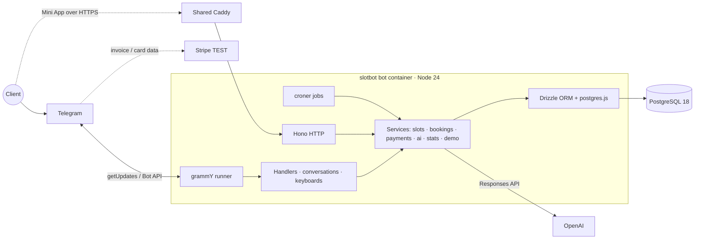

# SlotBot

Telegram booking bot for a demo barbershop — **Sharp & Co.**, Brooklyn. One Node process: grammY (long polling) + croner jobs + Hono. PostgreSQL via Drizzle.

Live demo (placeholder until BotFather bot exists): [t.me/slotbot_demo_bot](https://t.me/slotbot_demo_bot)

Screenshots go in [`docs/media/`](docs/media/) (`start.png`, `wizard.gif`, `invoice.png`, `admin-day.png`, `stats.png`, `xlsx.png`, `ru.png`).

## What it does

- Conversational booking wizard (service → master → calendar → time → confirm)
- Stripe TEST deposits via Telegram Payments, 15-minute slot holds
- Double-booking blocked by a PostgreSQL exclusion constraint
- Cancel / reschedule with a 2 h cutoff
- 24 h and 2 h reminders that survive restarts
- AI FAQ assistant with per-user and global cost caps
- Admin panel: schedule, catalog, hours, broadcast, stats, `.xlsx` export
- English + Russian, auto-detected
- Demo sandbox (`/admin_demo`) and nightly reset

## Architecture



## Stack

| Piece | Choice |
| --- | --- |
| Runtime | Node 24, pnpm 12.11, TypeScript 6 |
| Bot | grammY 1.46 + runner, conversations, i18n, auto-retry |
| DB | PostgreSQL 18, Drizzle 0.45, btree_gist exclusion |
| HTTP | Hono `/healthz` |
| Jobs | croner in-process |
| Payments | Telegram Payments + Stripe TEST |
| AI | OpenAI Responses API (`gpt-6-luna`) |
| Deploy | Docker Compose + shared Caddy |

## Getting started

Node 24 and pnpm 12.11.2 (`corepack prepare pnpm@12.11.2 --activate`). Docker for local Postgres.

```bash
pnpm install
cp .env.example .env   # set BOT_TOKEN from BotFather
pnpm db:up && pnpm db:migrate && pnpm db:seed
pnpm dev               # bot + http://127.0.0.1:3000/healthz
```

`pnpm typecheck && pnpm lint && pnpm format:check && pnpm build`

Without a real `BOT_TOKEN`, HTTP `/healthz` still starts (placeholder token skips polling). Telegram flows need a BotFather token. Payments need a Stripe TEST provider token containing `:TEST:`. AI needs `OPENAI_API_KEY`.

## Environment

See [`.env.example`](.env.example). Defaults: `ADMIN_IDS=494979019`, `SALON_TIMEZONE=America/New_York`, `DEMO_MODE=true`. Live payment tokens are refused at startup.

## Demo mode

- Test card `4242 4242 4242 4242`, any future expiry, any CVC
- `/admin_demo` — 30 min sandboxed admin (broadcasts only to you, names masked)
- Nightly reset at 04:00 salon time (or `pnpm db:seed`)

## Deployment

Hetzner VPS, Docker Compose project `slotbot`, clone at `/opt/slotbot`. Join external Docker network `proxy`. Paste [`deploy/Caddyfile.snippet`](deploy/Caddyfile.snippet) into the shared Caddyfile (`slotbot.<domain>` → `slotbot:3000`).

```bash
docker compose up -d --build
```

CI: GitHub Actions (format, lint, typecheck, build, drizzle-kit check). Deploy workflow SSHs and rebuilds. Host cron `15 3 * * *` → [`deploy/backup.sh`](deploy/backup.sh) (`pg_dump`, 14-day rotation).

MIT © 2026 Arseniy
