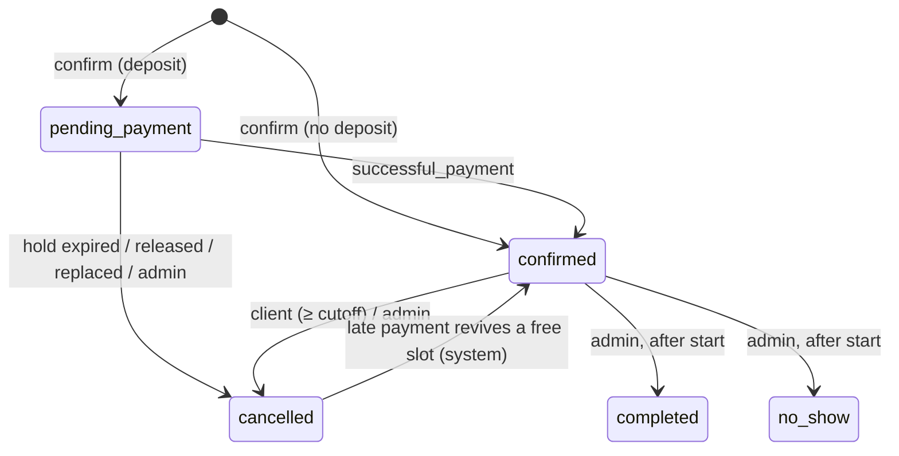

# SlotBot — Product Specification

Version 1.0 · 2026-10-15 · Owner: Arseniy · Status: ready for implementation

Related: [ARCHITECTURE.md](./ARCHITECTURE.md) (how) · [PLAN.md](./PLAN.md) (order of work)

---

## 1. Purpose

SlotBot is a public demo of a production-grade Telegram booking bot for a barbershop / beauty salon.
It is the centerpiece of a freelance portfolio (Fiverr / Upwork) aimed at non-CIS clients.

A prospective client opens the bot and, in about five minutes and without talking to anyone:
books a real (demo) appointment, pays a test deposit, sees the booking in "My bookings",
asks the AI assistant a question, then turns into an admin with `/admin_demo` and explores the
schedule, stats and Excel export.

What the demo proves, and where the client sees it:

| Capability | Visible as |
| --- | --- |
| Conversational UX | Edit-in-place booking wizard, inline calendar, colored buttons |
| Payments | Telegram Payments + Stripe TEST deposit, 15-minute slot hold |
| Database design | PostgreSQL; double booking is impossible even under races |
| Scheduled jobs | 24 h / 2 h reminders that survive restarts; hold expiry; nightly reset |
| AI | FAQ assistant grounded in live salon data, with per-user and global cost caps |
| Admin panel | Schedule, booking actions, catalog & hours editing, broadcast, stats, `.xlsx` export |
| i18n | English (default) + Russian, auto-detected, switchable |
| Mini App (Could) | React booking UI inside Telegram, same backend |
| Ops | Docker Compose on a VPS, HTTPS via Caddy, CI, JSON logs, health check |

## 2. Target client persona

**Primary — "Maria", owner of a 3–6 chair salon** (US / UK / EU / AU / Middle East).
Customers already message her in Telegram/WhatsApp; double bookings and no-shows cost money;
she wants deposits and reminders without paying for a SaaS seat per stylist. Non-technical:
judges by "does it work on my phone and look professional".

**Secondary — "Dan", CTO/PM at a small agency** hiring a freelancer for a client's booking or
ordering bot (nail studio, spa, clinic, tutor, car wash). Opens the GitHub repo, checks code
quality, schema, README, deployment story.

Implications:

- English-first, polished copy; Russian is a showcase of i18n, not the main audience.
- The happy path must work in under a minute; the demo must be self-explanatory (hints in `/start`).
- Business facts (name, address, services, hours) are data/config, so "adapt to my business" is obvious.
- README and code are part of the product.

## 3. Demo salon (seed content)

Fictional **Sharp & Co. Barbershop**, 42 Example St, Brooklyn, NY 11211 (fictional address),
phone +1 (555) 014-2290, time zone `America/New_York`, currency USD.
Salon hours text: Mon–Sat 10:00–20:00, Sun closed.

Services (stable seed IDs 1–6; user-created rows get IDs ≥ 1000):

| ID | Title (EN) | Title (RU) | Duration | Price | Deposit |
| --- | --- | --- | --- | --- | --- |
| 1 | Men's haircut | Мужская стрижка | 45 min | $35 | 0 % |
| 2 | Beard trim & shape | Оформление бороды | 30 min | $20 | 0 % |
| 3 | Haircut + beard | Стрижка + борода | 75 min | $50 | 30 % |
| 4 | Kids' haircut (under 12) | Детская стрижка (до 12 лет) | 30 min | $25 | 0 % |
| 5 | Hot towel shave | Бритьё с горячим полотенцем | 45 min | $40 | 30 % |
| 6 | Hair coloring | Окрашивание | 90 min | $80 | 50 % |

Masters (stable seed IDs 1–3):

| ID | Name | Services | Working hours (salon time) |
| --- | --- | --- | --- |
| 1 | Alex Rivera / Алекс Ривера | 1, 2, 3, 5 | Mon–Fri 10:00–19:00 |
| 2 | Jordan Lee / Джордан Ли | 1, 2, 3, 4 | Tue–Sat 11:00–20:00 |
| 3 | Sam Patel / Сэм Пател | 1, 4, 5, 6 | Mon, Wed–Sat 10:00–18:00 |

Seed bookings (regenerated on every reset, deterministic per date): 12 fake clients
(e.g. "Emma W.", "Liam K.") with negative Telegram IDs; ~65 % occupancy for the past 21 days
(80 % completed, 10 % no-show, 10 % cancelled) and ~40 % for the next 10 days (confirmed),
so the calendar, schedule and stats look alive. Seed deposits get fake payment rows.

## 4. Roles

| Role | Who | Rights |
| --- | --- | --- |
| Client | Any user in a private chat | Book, pay, manage own bookings, AI, settings |
| Owner admin | Telegram IDs in `ADMIN_IDS` | Everything, unmasked data, receives notifications |
| Demo admin | Anyone after `/admin_demo` (demo mode only), 30 min | Admin panel with sandbox rules (§10) |
| Master | Staff entity in DB, no Telegram role in v1 | — |

Group chats are ignored entirely.

## 5. Feature list (MoSCoW)

| ID | Feature | Priority |
| --- | --- | --- |
| F-01 | `/start` onboarding, persistent main menu, demo hints | Must |
| F-02 | Booking wizard: service → master (or "any") → calendar → time → confirm | Must |
| F-03 | Slot engine: working hours + duration + bookings + days off + lead time + horizon | Must |
| F-04 | Double-booking protection enforced by the database | Must |
| F-05 | Deposit prepayment via Telegram Payments (Stripe TEST); % per service + global switch | Must |
| F-06 | Unpaid holds expire after 15 min, slot freed, invoice deleted | Must |
| F-07 | My bookings: list, details, cancel, reschedule (2 h cutoff, max 2 reschedules) | Must |
| F-08 | Reminders 24 h and 2 h before the visit; persisted, idempotent | Must |
| F-09 | AI FAQ assistant (prices, address, hours, policies), suggests booking, refuses off-topic | Must |
| F-10 | i18n EN (default) / RU: auto-detect + switch in Settings | Must |
| F-11 | About, `/terms`, `/support`, `/help` | Must |
| F-12 | Owner notifications: new / cancelled / rescheduled bookings | Should |
| F-13 | Share phone number (Settings, `request_contact`) | Could |
| F-14 | Delete my data (Settings) | Could |
| F-15 | "Add to calendar" `.ics` file after booking | Could |
| A-01 | Admin access: owner via env, demo admin via `/admin_demo` | Must |
| A-02 | Day schedule (today / any day) grouped by master | Must |
| A-03 | Booking card actions: completed / no-show / cancel / mark refunded | Must |
| A-04 | Upcoming bookings list (paginated) | Must |
| A-05 | Services: create, edit title/price/duration/deposit, assign masters, activate/deactivate | Must |
| A-06 | Masters: create, rename, assign services, activate/deactivate | Must |
| A-07 | Working hours per master per weekday (presets + custom) | Must |
| A-08 | Day off for a master on a date | Should |
| A-09 | Broadcast to all clients (demo: only to yourself) | Must |
| A-10 | Stats: bookings by status, revenue, deposits, no-show rate, top services/masters | Must |
| A-11 | Export bookings to `.xlsx` | Must |
| A-12 | "Restore demo catalog" button (cooldown 10 min) | Should |
| P-01 | Demo mode sandbox + nightly full reset | Must |
| P-02 | Rate limits, booking limits, AI cost caps | Must |
| P-03 | Health endpoint, JSON logs, graceful shutdown | Must |
| P-04 | Docker Compose deploy behind shared Caddy (HTTPS), GitHub Actions CI/CD | Must |
| P-05 | Telegram Mini App booking UI (React) | Could |
| P-06 | Nightly `pg_dump` backup on the VPS | Should |

## 6. Commands and main menu

Bot commands (registered with `setMyCommands` for `en` and `ru`):

| Command | Who | Action |
| --- | --- | --- |
| `/start [payload]` | all | Welcome + main menu. Payloads: `book`, `my`, `pay-<bookingId>` |
| `/book` | all | Booking wizard step 1 |
| `/my` | all | My bookings |
| `/ask` | all | AI assistant intro (then just type) |
| `/about` | all | Salon info |
| `/settings` | all | Language, phone, delete data |
| `/help` | all | What the bot can do + commands |
| `/terms` | all | Terms & cancellation/deposit policy |
| `/support` | all | Salon contacts |
| `/cancel` | all | Leave any text-input flow |
| `/admin` | admins | Admin panel |
| `/admin_demo` | all, demo mode | Grant 30-min demo admin |

Main menu = persistent reply keyboard (resized):

```
[ 📅 Book an appointment ]
[ 🗓 My bookings ] [ 💬 Ask a question ]
[ ℹ️ About us ]    [ ⚙️ Settings ]
[ 🛠 Admin panel ]                      ← only for owner/demo admins
```

Any other text message in a private chat (not a command, not inside a text-input flow) goes to the
AI assistant. Unknown `/commands` get the help text.

## 7. User flows

Conventions for all inline screens:

- One wizard message is **edited in place**; every screen has "⬅ Back" (except the first) and "✖ Cancel".
- Primary action buttons use `success` style, destructive use `danger`.
- Every callback is re-validated server-side; if state changed, the bot shows a toast and re-renders a fresh screen.
- Times are always shown in salon time with a short zone label, e.g. "2:30 PM (New York time)".

### 7.1 Onboarding (F-01)

1. `/start` → upsert user, pick locale (§7.10), send welcome + main menu keyboard.
2. If `DEMO_MODE=true`, append the demo hints block with a "📋 Copy test card" button
   (`copy_text` = `4242 4242 4242 4242`) and "🛠 Try admin panel" (= `/admin_demo`).
3. Deep links: `/start book` → step 1; `/start my` → My bookings; `/start pay-<id>` → re-send the invoice if the hold is still active.

### 7.2 Booking wizard (F-02, F-03)

**S1 · Service.** Text: "Step 1/4 · Choose a service". One button per active service with at least one
active master: `Men's haircut · 45 min · $35` (deposit services get a `💳` suffix). Rows of 1.

**S2 · Master.** "Step 2/4 · Choose a master" + service line. Buttons: `✨ Any available master`, then
each active master offering the service. Back → S1.

**S3 · Date.** "Step 3/4 · Pick a date" + "Times are shown in salon time (New York)." Month grid:
header `October 2026`, weekday row (Mo…Su, localized), day cells. Day with ≥ 1 free slot → normal button;
past / no availability / beyond horizon → disabled button showing the day number; blank cells for
padding. Navigation row `‹` `›` only within [today, today + horizon]. Back → S2.

**S4 · Time.** "Step 4/4 · Pick a time" + `Fri, Oct 16`. Grid of 4 buttons per row with start times.
For "any master", the union of all masters' free starts. Back → S3 (same month).

**S5 · Confirm.**

```
Please confirm your booking
💇 Men's haircut — 45 min
👤 Alex Rivera
📅 Fri, Oct 16 · 2:30 PM (New York time)
💵 Price: $35.00
💳 Deposit now: $10.50 · rest at the salon        ← only if deposit applies
↩️ Free cancellation or rescheduling up to 2 h before the visit.
By confirming you agree to the /terms.
```

For "any master", S5 already shows the concrete master chosen by the bot (least booked that day,
tie → sort order). Buttons: `✅ Confirm` (or `✅ Confirm & pay deposit`), `⬅ Back`, `✖ Cancel`.

**S6 · Result.**

- No deposit (or payments disabled) → booking `confirmed`; the wizard message becomes the booking card
  with `🗓 My bookings` and `📍 Directions` (URL) buttons; owner notified.
- Deposit → booking `pending_payment`, hold 15 min; wizard message becomes
  "⏳ I'm holding this slot for 15 minutes. Pay the deposit below to confirm it." with `✖ Release slot`;
  an invoice message follows (§7.3).

Rejections at confirm (each with a toast + fresh screen): slot taken, slot now too soon,
service/master inactive, user already has `MAX_ACTIVE_BOOKINGS_PER_USER` upcoming bookings.
If the user already holds another unpaid slot, it is released (reason `replaced`) and the message says so.

### 7.3 Deposit payment (F-05, F-06)

1. Invoice: title `Deposit · Men's haircut`, description `Fri, Oct 16, 2:30 PM with Alex Rivera. The remaining $24.50 is paid at the salon.`,
   one price line `Deposit`, currency from env, single-chat invoice (start parameter `pay-<id>`).
2. User pays in Telegram's native sheet (test card `4242 4242 4242 4242`, any future expiry, any CVC).
3. `pre_checkout_query` → approve only if the booking is still `pending_payment`, belongs to the payer,
   hold not expired, amount and currency match; approval extends the hold by 5 min so the payment can't race the expiry job.
   Otherwise decline with "This slot hold has expired. Please book again — it takes a minute."
4. `successful_payment` → payment row stored (idempotent by Telegram charge ID), booking `confirmed`,
   message "✅ Payment received — your booking is confirmed!" + card. Owner notified.
5. Hold expires (job, ≤ 30 s granularity) → booking `cancelled` (`payment_timeout`), invoice message deleted,
   user gets "⌛ Your hold for Men's haircut on Fri, Oct 16 has expired and the slot was released."
6. Edge: payment succeeds although the hold was already released → the bot tries to re-confirm the slot;
   if someone took it, the payment is marked `refund_pending`, the user gets an apology, the owner an alert.

Paid booking cancelled by the client (≥ cutoff) or by an admin → payment `refund_pending`; text:
"Your $10.50 deposit will be refunded. (Test mode — no real money was charged.)" Admin later taps "Mark refunded".
Refunds themselves happen in the Stripe dashboard (Bot API refunds exist only for Telegram Stars).

### 7.4 My bookings (F-07)

- List: upcoming `confirmed` + `pending_payment`, soonest first, 6 per page, buttons
  `Fri, Oct 16 · 2:30 PM · Men's haircut` (`⏳` prefix when unpaid). Empty state: "No upcoming bookings yet." + `📅 Book`.
- Card: service, master, date/time, price, deposit status, status line. Buttons:
  - `🔁 Reschedule` and `✖ Cancel booking` — only if ≥ `CHANGE_CUTOFF_HOURS` before start
    (reschedule also requires `reschedule_count < MAX_RESCHEDULES`);
  - `💳 Pay deposit` — only for `pending_payment` with an active hold (re-sends invoice);
  - `📍 Directions` (URL), `⬅ Back`.
  - Inside the cutoff: "Changes are possible up to 2 h before the visit. Please contact the salon: /support".
- Cancel → confirm screen "Cancel Men's haircut on Fri, Oct 16 at 2:30 PM?" `Yes, cancel` (danger) / `Keep it`.
- Reschedule → S3/S4 for the same service and master (calendar excludes the booking itself from busy time),
  confirm screen "Move to Sat, Oct 17 · 11:00 AM?" → the same booking row moves; reminders reset; owner notified.

### 7.5 Reminders (F-08)

| Reminder | Sent when | Skipped when | Buttons |
| --- | --- | --- | --- |
| 24 h | now ≥ start − 24 h and now < start − 2 h | slot was assigned < 24 h before start | Reschedule, Cancel, Directions |
| 2 h | now ≥ start − 2 h and now < start | slot was assigned < 2 h before start | Directions |

Only `confirmed` bookings of real users who haven't blocked the bot. Each reminder is sent at most once,
including across restarts; after downtime the 2 h reminder still goes out if the visit hasn't started.

Copy: "⏰ Reminder: tomorrow at 2:30 PM — Men's haircut with Alex Rivera. 📍 42 Example St, Brooklyn" and
"⏰ See you in 2 hours! 2:30 PM — Men's haircut with Alex Rivera."

### 7.6 AI assistant (F-09)

- Entry: `💬 Ask a question` / `/ask` → "Ask me anything about our services, prices, hours or policies — just type your question. Questions left today: 10."
- Any free text → typing indicator → answer (≤ ~120 words) in the user's language.
- Grounding: salon facts, services with prices/durations/deposits, masters and their services, working hours,
  policies (cutoff, deposit, hold) and a free-text FAQ file. No booking data of other users ever goes into the prompt.
- If the model detects booking intent → `📅 Book now` button (service preselected if identified).
- Off-topic (coding, politics, other businesses…) → polite refusal + offer to help with booking.
- Unknown facts → "I'm not sure — please contact the salon: /support". Never invents prices.
- Limits: 10 questions/user/day (salon-local day), global caps per day: 500 requests or $1.00 estimated cost.
  Messages: "You've reached today's limit of 10 questions. It resets at midnight (New York time)." /
  "Our assistant is resting for today. See /about or contact /support."
- Questions longer than 500 characters are truncated with a note. AI disabled (no API key) → "The AI assistant is not configured in this deployment."

### 7.7 About, terms, support, help (F-11)

- About: name, address, phone, salon hours text, `📍 Open in Maps`, `📅 Book`.
- Terms: deposits, cancellation (free ≥ 2 h; deposit refunded), no-show (deposit kept), holds (15 min), data use, demo notice.
- Support: phone, address, Telegram contact; "Telegram support cannot help with payments made via this bot."
- Help: short feature list + commands.

### 7.8 Settings (F-10, F-13, F-14)

`🌐 Language` → `English` / `Русский` (current marked ✓) → saves, re-renders, re-sends main menu keyboard in the new language.
`📱 Share phone` (Could) → reply keyboard with `request_contact`; stored and shown to admins (masked for demo admins).
`🗑 Delete my data` (Could) → confirm → anonymize name/username/phone, cancel future bookings, keep anonymous history for stats.

### 7.9 Admin panel (A-01 … A-12)

Entry: `🛠 Admin panel` / `/admin`. Every admin screen re-checks the role; an expired demo admin gets
"Your demo admin session has ended. Tap /admin_demo to start a new one."

**Home**

```
🛠 Admin panel · Sharp & Co. Barbershop
Today: 7 bookings · 1 awaiting payment
🧪 Demo admin · 24 min left · sandboxed, resets nightly      ← demo admins only
[📅 Today] [🗓 Pick a day]
[📋 Upcoming] [📊 Stats]
[💇 Services] [👤 Masters]
[⏰ Working hours] [📣 Broadcast]
[📥 Export .xlsx] [♻️ Restore demo]                         ← restore: demo mode only
```

**Day schedule** — header `Fri, Oct 16`; per master a block `👤 Alex Rivera · 10:00–19:00` with lines
`✅ 10:00–10:45 Men's haircut · Emma W.` (status emoji: ✅ confirmed, ⏳ pending, ✔️ completed, 🚫 no-show; cancelled hidden).
Buttons: one per booking (max 20; then "+N more" note), `‹ Prev day` `Today` `Next day ›`, `🌴 Day off: <master>` toggles (A-08), `⬅ Admin`.
"Pick a day" opens the same month calendar (all days enabled within −30 … +horizon).

**Booking card (admin)** — all fields incl. client name, @username, phone (masked per §10), payment status, source, created at.
Actions by state:
- `confirmed`, start passed → `✔️ Completed`, `🚫 No-show`;
- `confirmed` / `pending_payment`, start not passed → `✖ Cancel booking` (confirm step; client notified: "Your booking … was cancelled by the salon.");
- payment `refund_pending` → `💸 Mark refunded`.

**Upcoming** — paginated list (8/page) of future `confirmed` + `pending_payment` bookings → booking card.

**Services** — list with `🟢/⚪️` active markers + `➕ New service`. Service card buttons: `✏️ Title`, `💲 Price`,
`⏱ Duration` (15–240 step 15 picker), `💳 Deposit` (0/30/50/100 %), `👥 Masters` (checkbox toggles), `🟢 Active`/`⚪️ Inactive` toggle.
New service = text-input flow: title EN → title RU (`Skip`) → duration (buttons) → price (number like `35` or `35.50`) → deposit (buttons) → masters (toggles, `Done`).

**Masters** — list + `➕ New master`. Card: `✏️ Name`, `💇 Services` (toggles), `⏰ Working hours`, active toggle.
New master flow: name EN → name RU (`Skip`) → services toggles → hours preset for Mon–Sat.

**Working hours** — pick master → 7 rows `Mon 10:00–19:00` / `Sun — day off` → pick weekday → presets
`Day off`, `09:00–18:00`, `10:00–19:00`, `10:00–20:00`, `11:00–20:00`, `Custom…` (text `HH:MM-HH:MM`, 30-min grid).
After a change: "Saved. 2 existing bookings fall outside the new hours — they are kept; contact the clients if needed."

**Broadcast** — text-input flow: "Send the message text (max 1000 characters)." → preview + "Recipients: 128" (demo: "Demo mode: will be sent only to you") →
`📣 Send` / `✖ Cancel` → progress message updated at the end: "Sent: 127 · Failed: 1".

**Stats** — period buttons `7 days` / `30 days` / `This month`:

```
📊 Stats · Oct 1 – Oct 15
Bookings: 64  (✔️ 48 · 🚫 5 · ✖ 6 · upcoming 5)
Revenue (completed): $2,140.00
Deposits collected: $310.50 · refunds pending: $10.50
No-show rate: 9 %
Top services: 1) Men's haircut 26 ▇▇▇▇▇  2) Haircut + beard 14 ▇▇▇  3) Beard trim 9 ▇▇
Top masters: 1) Jordan Lee 25  2) Alex Rivera 22  3) Sam Patel 17
New clients: 12
```

**Export** — same period picker → `.xlsx` document `slotbot-bookings-2026-10-01_2026-10-15.xlsx` with sheets
`Bookings` (ID, date, time, master, service, client, phone, status, price, deposit, payment status, source, created at; header bold, frozen, autofilter)
and `Summary` (the stats above).

**Restore demo (A-12)** — confirm → restores seed services, masters, assignments and hours to original values,
deactivates items created by demo admins, removes days off. Keeps all bookings. Global cooldown 10 min:
"Demo data was restored 3 min ago — try again in 7 min."

### 7.10 Language (F-10)

Locale = user's saved choice, else `ru` if Telegram `language_code` starts with `ru`, else `en`.
Everything user-facing is localized: messages, buttons, dates (`Fri, Oct 16` / `пт, 16 окт.`), times (`2:30 PM` / `14:30`),
money (`$35.00` / `35,00 $`), service/master names (RU column falls back to EN). Reminders and broadcasts use the recipient's locale.

### 7.11 Mini App (P-05, Could)

Opened from the chat menu button `📅 Book` and from `/start`. Screens: Services → Master → Date (two-week strip + month view) →
Time → Confirm (Telegram MainButton "Book · $35") → Done (or native invoice sheet for deposits) and a "My bookings" tab with cancel.
Uses Telegram theme colors, BackButton, haptic feedback. Same rules, limits and data as the bot; bookings created in the
Mini App appear in the chat with the same confirmation message and reminders.

## 8. Business rules

| Rule | Default (env) |
| --- | --- |
| Slot step | 15 min (`SLOT_STEP_MINUTES`) |
| Minimum lead time | 60 min (`MIN_LEAD_MINUTES`) |
| Booking horizon | 30 days (`BOOKING_HORIZON_DAYS`) |
| Change cutoff | 2 h before start (`CHANGE_CUTOFF_HOURS`) |
| Max reschedules per booking | 2 (`MAX_RESCHEDULES`) |
| Max upcoming bookings per user | 3 (`MAX_ACTIVE_BOOKINGS_PER_USER`) |
| Unpaid holds per user | 1 (DB-enforced) |
| Hold duration | 15 min (`HOLD_MINUTES`) |
| Deposit | `ceil(price × prepay% / 100)`, raised to the currency minimum ($1.00), capped at price |
| AI limits | 10/user/day, 500 requests/day, $1.00/day (`AI_*`) |
| Demo admin session | 30 min (`DEMO_ADMIN_MINUTES`) |
| Nightly reset | 04:00 salon time (`DEMO_RESET_CRON`) |

Slot validity: a start time `t` for master `m` and duration `d` is free iff `[t, t+d)` lies inside m's working interval
for that local weekday, does not overlap any non-cancelled booking of m or any day off of m, `t ≥ now + lead`,
and `t < today + horizon`. Starts are aligned to the slot step from the working-interval start.
Working hours are one interval per weekday (no breaks in v1); local times that don't exist on DST days are skipped.

Booking status machine:



Payment statuses: `succeeded` → `refund_pending` (cancellation of a paid booking, or late payment for a lost slot) → `refunded` (admin).

## 9. User-facing copy (EN source)

Final strings live in `apps/bot/locales/en.ftl`; RU is translated there. Tone: friendly, short, no exclamation spam, emoji as icons only.

| Key | Text |
| --- | --- |
| `welcome` | 👋 Welcome to **{salon}**! I can book your visit in under a minute, remind you before it and answer questions about prices and services. |
| `demo-hints` | 🧪 **Demo mode** · Payments run in Stripe TEST mode: card `4242 4242 4242 4242`, any future date, any CVC — no real money. · Try the admin panel: /admin_demo (30 min). · Demo data resets every night at 04:00 ({tz}). |
| `slot-taken` | 😕 Sorry, that time was just taken. Here are the remaining times: |
| `slot-too-soon` | That time is too soon now — bookings close {minutes} min before the start. |
| `limit-active` | You already have {count} upcoming bookings — that's the maximum. Manage them in 🗓 My bookings. |
| `hold-replaced` | Your previous unpaid hold was released. |
| `booked` | ✅ **You're booked!** We'll remind you 24 h and 2 h before the visit. |
| `hold-started` | ⏳ I'm holding this slot for **{minutes} minutes**. Pay the deposit below to confirm it. |
| `paid` | ✅ **Payment received — your booking is confirmed!** |
| `hold-expired` | ⌛ Your hold for {service} on {date} has expired and the slot was released. Book again any time: /book |
| `precheckout-expired` | This slot hold has expired. Please book again — it takes a minute. |
| `cutoff` | Changes are possible up to {hours} h before the visit. Please contact the salon: /support |
| `cancelled-by-client` | Your booking for {service} on {date} is cancelled. |
| `deposit-refund` | Your {amount} deposit will be refunded. (Test mode — no real money was charged.) |
| `cancelled-by-salon` | Your booking for {service} on {date} was cancelled by the salon. We're sorry for the inconvenience. |
| `rescheduled` | 🔁 Done! Your booking is moved to {date}. |
| `reminder-24h` | ⏰ Reminder: tomorrow at {time} — {service} with {master}. 📍 {address} |
| `reminder-2h` | ⏰ See you in 2 hours! {time} — {service} with {master}. |
| `ai-intro` | 💬 Ask me anything about our services, prices, hours or policies — just type your question. Questions left today: {left}. |
| `ai-limit-user` | You've reached today's limit of {limit} questions. It resets at midnight ({tz}). You can still book: /book |
| `ai-limit-global` | Our assistant is resting for today. See /about or contact /support. |
| `ai-error` | I couldn't answer right now. Please try again in a minute. |
| `admin-demo-granted` | 🛠 **Demo admin access for {minutes} minutes.** Explore the schedule, services, masters, hours, stats and Excel export. Sandbox: broadcasts go only to you; you can change only demo bookings and your own; other visitors' names are masked; everything resets nightly. |
| `admin-demo-expired` | Your demo admin session has ended. Tap /admin_demo to start a new one. |
| `admin-only` | This section is for salon staff. |
| `sandbox-denied` | 🧪 Sandboxed in demo mode: you can change only demo bookings and your own. |
| `protected-item` | 🧪 This demo item is protected — edit it, but it can't be deactivated. |
| `outdated` | This button is outdated — here is the current view. |
| `error-generic` | Something went wrong on our side. Please try again. |

## 10. Demo-mode rules (`DEMO_MODE=true`)

Goal: a visiting client can try everything; nobody can break the demo for others, spam people, see others' data or spend money.

1. **Payments** are always test: the bot refuses to start if `PAYMENT_PROVIDER_TOKEN` lacks `:TEST:`. Hints show the test card.
2. **`/admin_demo`** grants a demo admin role for 30 min (re-grant only after expiry). Owner admins are never downgraded.
3. **Privacy**: demo admins see other real visitors as initial + `***` (e.g. `J***`), no username, no phone — in the bot, stats and `.xlsx`.
   Seed clients (fake) and the viewer's own bookings are shown in full.
4. **Booking actions** (complete / no-show / cancel / refunded) by demo admins only on seed bookings and their own bookings.
5. **Broadcast** by demo admins goes only to the sender; recipients count shows 1.
6. **Catalog**: demo admins may create and edit anything; seed services/masters (IDs < 1000) can't be deactivated.
   Working hours and days off are editable; "Restore demo" undoes catalog/hour changes for everyone (cooldown 10 min).
7. **Nightly reset** at 04:00 salon time: delete all bookings, payments, days off, broadcasts, demo-created services/masters;
   restore seed catalog and hours; regenerate seed bookings; expire all demo admin sessions; prune AI usage older than 30 days. Users are kept.
8. **Never message seed clients** (negative Telegram IDs). Notifications caused by demo admins to real users are impossible by rule 4.
9. **Limits**: per-user update rate (4 per 2 s), 3 upcoming bookings, 1 unpaid hold, AI 10/day + global caps, text inputs ≤ 1000 chars.
10. `/start` explains all of the above in two lines; the admin home shows the remaining demo minutes.

With `DEMO_MODE=false` the bot behaves as a normal single-salon bot: no `/admin_demo`, no reset, no masking for owner admins.

## 11. Non-functional requirements

- **Responsiveness**: callback/menu responses p95 < 1 s on the VPS (AI excluded); AI answer < 10 s or a friendly timeout.
- **Reliability**: restart at any moment loses no holds, payments or reminders; `successful_payment` processing is idempotent;
  every callback is answered (no endless spinners).
- **Correctness**: two users confirming the same slot concurrently → exactly one booking; DST days render correct local times.
- **Resource budget**: bot container < 200 MB RAM, Postgres < 300 MB; shares a small Hetzner VPS with other projects.
- **Security**: secrets only in env; Postgres not exposed; admin rights checked on every action; Mini App requests authenticated by initData HMAC.
- **Observability**: JSON logs (pino) with module, update ID, user ID; `/healthz` checks DB; errors never leak stack traces to users.
- **Maintainability**: TypeScript strict, ESLint + Prettier clean, layered code (handlers → services → db), all copy in locale files.
- **Localization**: no hard-coded user-facing strings outside `locales/*.ftl` (Mini App: its own small dictionary).
- **Accessibility/UX**: ≤ 4 buttons per row, text labels with emoji (not emoji-only), edit-in-place to avoid chat clutter.

## 12. Out of scope (v1)

LIVE payments and automatic refunds; Telegram Stars; multi-salon / multi-tenant; web admin dashboard; master (staff) Telegram accounts
and their notifications; SMS / e-mail / WhatsApp; Google/Apple calendar sync (only optional `.ics`); waitlists, recurring or group
bookings, multiple services per booking (combos are separate services); breaks inside working hours; promo codes, loyalty, reviews,
tips; webhook mode and horizontal scaling; automated tests (owner rule — verification is manual); analytics beyond the stats screen.

## 13. Acceptance criteria (whole project)

- **AC-01** Fresh clone → `pnpm install`, `pnpm db:up`, `pnpm db:migrate`, `pnpm db:seed`, `pnpm dev` → bot answers `/start` within 1 s.
- **AC-02** A client completes S1→S6 for a no-deposit service in ≤ 6 taps; the booking appears in My bookings and in the admin day schedule.
- **AC-03** A deposit service shows the invoice; paying with `4242 4242 4242 4242` confirms the booking; card `4000 0000 0000 0002` is declined by Stripe and the hold stays until expiry.
- **AC-04** An unpaid hold disappears ≤ 16 min after creation; the invoice is deleted; the slot is offered again.
- **AC-05** Two accounts confirming the same slot (or a manual SQL insert overlapping an existing booking) → only one booking exists; the other user sees "slot taken".
- **AC-06** Cancel and reschedule work ≥ 2 h before start, are hidden/refused inside 2 h, reschedule limited to 2.
- **AC-07** A booking starting in ~25 h receives the 24 h and 2 h reminders exactly once each, even with a bot restart in between.
- **AC-08** AI answers price/address/hours questions correctly in EN and RU, refuses an off-topic question, shows "Book now" for booking intent, stops after 10 questions/day.
- **AC-09** `/admin_demo` grants 30-min access; broadcast reaches only the sender; other visitors' names are masked; actions on other visitors' bookings are refused; seed items can't be deactivated.
- **AC-10** Admin can create a service, assign a master, change hours; the booking wizard reflects it immediately; "Restore demo" reverts it.
- **AC-11** Stats and `.xlsx` export show consistent numbers for the same period; the file opens in Excel/Numbers/Google Sheets.
- **AC-12** Switching to Русский changes menu, wizard, dates, money and reminders; a user with RU Telegram language starts in Russian.
- **AC-13** Nightly reset (or `pnpm db:seed`, which runs the same function) restores the seed state without touching users.
- **AC-14** Production: `https://slotbot.<domain>/healthz` returns `200 {"ok":true}`; `docker compose up -d --build` redeploys with no lost data; CI is green.
- **AC-15** `pnpm typecheck`, `pnpm lint`, `pnpm format:check`, `pnpm build` pass with zero errors.
- **AC-16** README has a live bot link, GIF/screenshots, feature list, architecture diagram and runnable setup steps.
- **AC-17** (Could) Mini App books, pays and cancels with the same rules; forged or > 24 h old initData is rejected with 401.
